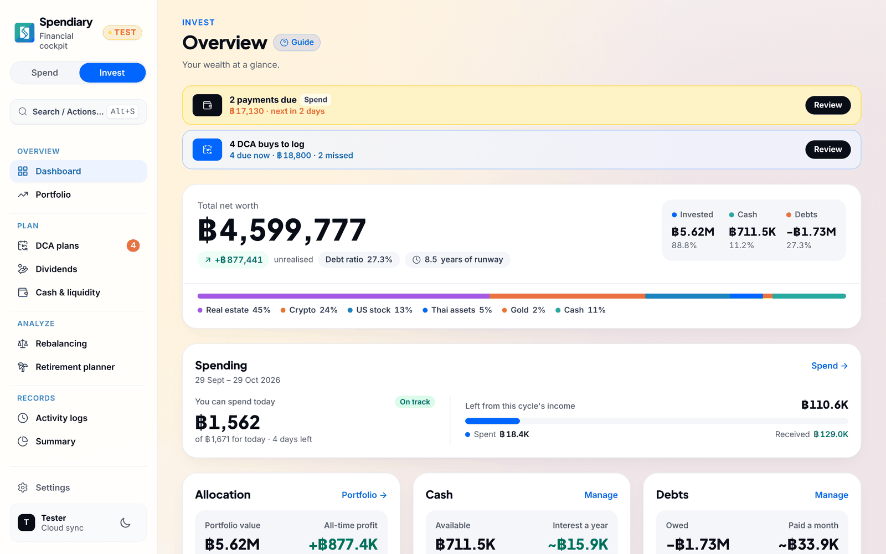
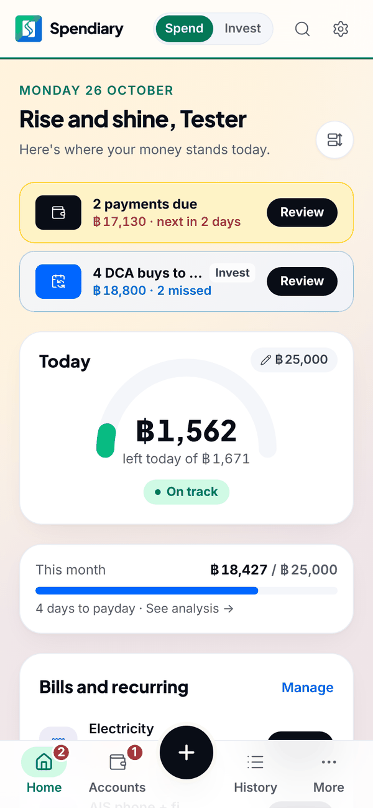
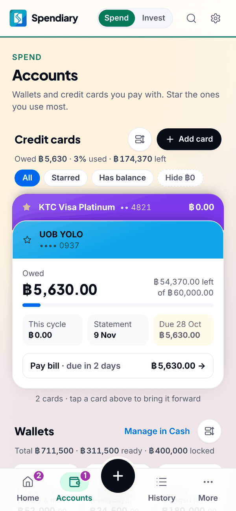
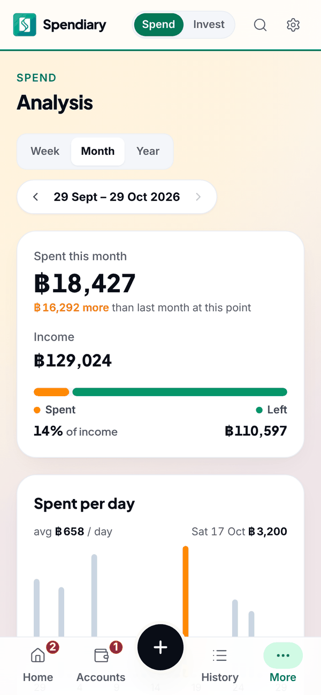
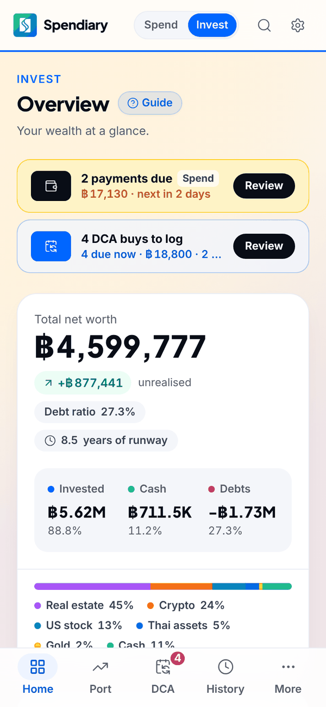
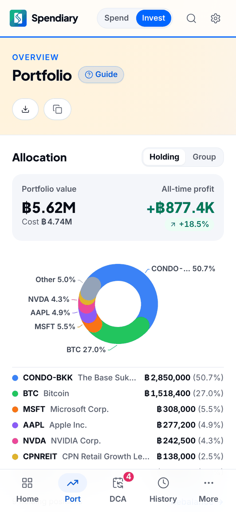
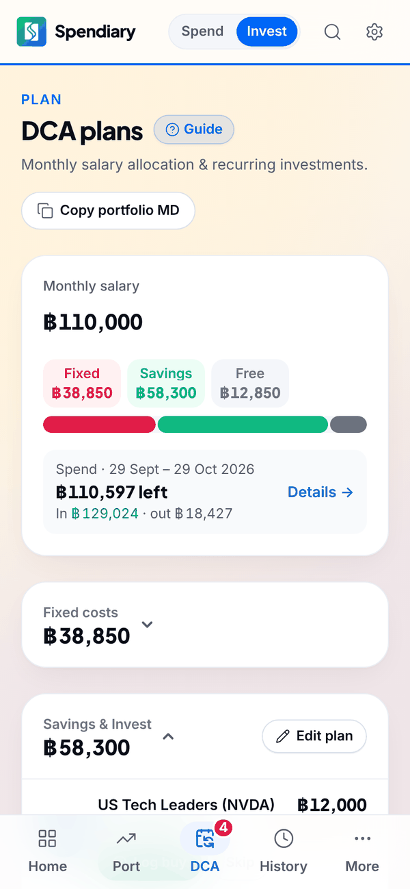
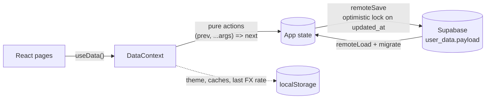

<div align="center">


# Spendiary

**A calm, private financial cockpit for spending and investing, in Thai Baht.**

Daily spending, cards and bills on one side. Portfolio, DCA, dividends and retirement on the other.
One app, one source of truth, no confetti.

[](https://github.com/bbrightns/spendiary/actions/workflows/ci.yml)


[Features](#features) · [Screenshots](#screenshots) · [Quick start](#quick-start) · [How data works](#how-data-works) · [Project map](#project-map)

<br />

<picture>
  <source media="(prefers-color-scheme: dark)" srcset="docs/screenshots/desktop-dark.png" />
  
</picture>

</div>

---

## Features

<table>
<tr>
<td width="50%" valign="top">

### Spend

- **Today's allowance** — how much you can still spend today, and whether the month is on track
- **Accounts & cards** — wallets, bank accounts and credit cards with cycles, statements and due dates
- **Bills & recurring** — upcoming payments surface before they're due
- **Loans & installments** — what you owe and what leaves each month
- **Budgets & analysis** — per-day spend, category totals, 6-month trends
- **Quick add & CSV import** — log in a tap, or paste a bank statement

</td>
<td width="50%" valign="top">

### Invest

- **Net worth** — invested, cash and debts in one number
- **Portfolio** — funds, stocks, crypto, gold, real estate and cash, with P/L
- **DCA plans** — salary split into fixed costs, savings and investing; buys to log on their day
- **Dividends** — expected yield, received, tax withheld
- **Rebalancing** — drift from target allocation
- **Retirement planner** — retire age, lump sum or yearly drawdown
- **Activity log** — every buy, sell and change, summarised

</td>
</tr>
</table>

> [!NOTE]
> Amounts are in **Thai Baht (THB)**. USD amounts use a real USD/THB rate, live or the last one fetched. The app never uses a guessed rate (`src/lib/fx.ts`).

## Screenshots

Light and dark follow your GitHub theme.

<table>
<tr>
<td align="center" width="33%">
<picture>
  <source media="(prefers-color-scheme: dark)" srcset="docs/screenshots/spend-dark.png" />
  
</picture>
<br /><sub><b>Spend home</b> · today's allowance</sub>
</td>
<td align="center" width="33%">
<picture>
  <source media="(prefers-color-scheme: dark)" srcset="docs/screenshots/accounts-dark.png" />
  
</picture>
<br /><sub><b>Accounts</b> · cards & wallets</sub>
</td>
<td align="center" width="33%">
<picture>
  <source media="(prefers-color-scheme: dark)" srcset="docs/screenshots/analysis-dark.png" />
  
</picture>
<br /><sub><b>Analysis</b> · spent per day</sub>
</td>
</tr>
<tr>
<td align="center">
<picture>
  <source media="(prefers-color-scheme: dark)" srcset="docs/screenshots/invest-dark.png" />
  
</picture>
<br /><sub><b>Invest overview</b> · net worth</sub>
</td>
<td align="center">
<picture>
  <source media="(prefers-color-scheme: dark)" srcset="docs/screenshots/portfolio-dark.png" />
  
</picture>
<br /><sub><b>Portfolio</b> · allocation & P/L</sub>
</td>
<td align="center">
<picture>
  <source media="(prefers-color-scheme: dark)" srcset="docs/screenshots/dca-dark.png" />
  
</picture>
<br /><sub><b>DCA plans</b> · salary allocation</sub>
</td>
</tr>
</table>

<sub>Screens are from <b>Explore Demo</b> mode, so all numbers are sample data.</sub>

## Quick start

```bash
npm install
cp .env.example .env   # fill in your Supabase URL and publishable key
npm run dev            # http://localhost:3000
```

> [!TIP]
> No Supabase project? Skip the `.env` and pick **Explore Demo / Offline Mode** on the sign-in screen. It runs on in-memory sample data and saves nothing.

| Command | What it does |
| --- | --- |
| `npm run dev` | Dev server with hot reload |
| `npm run build` | Type-check + production bundle into `dist/` |
| `npm run preview` | Serve the production build |
| `npm run lint` | ESLint (0 errors required) |
| `npm run lint:design` | Design-system rules from `DESIGN.md` |
| `npm test` | Vitest unit tests for the pure logic |

CI (`.github/workflows/ci.yml`) runs lint, lint:design, test and build on every pull request and every push to `main`.

### Environment variables

| Name | Value |
| --- | --- |
| `VITE_API_URL` | Supabase project URL (`https://<project-ref>.supabase.co`) |
| `VITE_API_TOKEN` | Supabase **publishable / anon** key, never the `service_role` key |

> [!IMPORTANT]
> Both end up in the browser bundle, so they are public by design. Row Level Security protects the data. In Vercel, set them under **Project Settings → Environment Variables**. `.env` is git-ignored.

## Tech stack

| Layer | Choice |
| --- | --- |
| UI | **React 18** + **TypeScript**, **React Router**, `lucide-react` icons |
| Styling | **Tailwind CSS v4**, design tokens in `@theme` (see `DESIGN.md`) |
| Build | **Vite** |
| Backend | **Supabase**: Google sign-in, Postgres with RLS, an Edge Function for stock prices |
| Tests | **Vitest** on pure logic |
| Hosting | **Vercel**, deployed from `main` |

## How data works



- **One row per user** in `public.user_data`: `id` (auth id), `payload` (all app data as JSON) and `updated_at`.
- **Row Level Security** limits every policy to `id = auth.uid()`. See `supabase/sql/user_data_rls.sql`.
- **Loading** (`src/store/remoteLoad.ts`, `useCloudSync.ts`) ends as *loaded*, *empty* or *failed*. Saving only turns on after a confirmed load, so a failed load can never overwrite the cloud row. Until data is loaded, pages and Quick add stay closed.
- **Saving** (`src/store/remoteSave.ts`) uses an optimistic lock on `updated_at`. If another tab or device saved first, nothing is written and the app shows *"Changed on another device"*.
- **Migration**: old saved data is upgraded on load (`src/store/migrate.ts`, `src/modules/spend/migrate.ts`).
- **`localStorage`** only holds per-device things: theme, view preferences, last sync time, the last USD/THB rate and price caches.

## Project map

<details>
<summary><b>Where things live</b></summary>

<br />

| Path | What |
| --- | --- |
| `src/store/DataContext.tsx` | `useData()`, the app-wide data and actions |
| `src/store/actions/` | Pure data changes: `(prev, ...args) => next` |
| `src/store/useAuth.ts`, `useCloudSync.ts` | Sign-in, load and save |
| `src/lib/types.ts` | Data types |
| `src/lib/calc.ts` | Derived numbers: net worth, allocation, P/L, DCA |
| `src/lib/format.ts` | Money and date formatting (`localDateStr()` for local calendar days) |
| `src/lib/fx.ts` | The single USD/THB source |
| `src/modules/spend/` | The Spend side |
| `src/pages/` | The Invest side and Settings |
| `supabase/functions/smart-responder/` | Edge Function for stock price and symbol lookup |
| `supabase/sql/` | SQL to run by hand in the Supabase dashboard |

</details>

<details>
<summary><b>Docs in this repo</b></summary>

<br />

| File | What |
| --- | --- |
| [`PRODUCT.md`](PRODUCT.md) | Who it's for, brand personality, design principles |
| [`DESIGN.md`](DESIGN.md) | Design system: tokens, components, rules enforced by `lint:design` |
| [`AGENTS.md`](AGENTS.md) | Rules for contributors and AI agents: commits, versioning, shipping |
| [`docs/`](docs) | Plans and architecture notes |

</details>

## Design principles

**Premium · Precise · Calm.** Numbers over noise. Color is earned: red and green mean something. Private by default. Spendiary tracks, it doesn't trade, so there are no excitement mechanics. More in [`PRODUCT.md`](PRODUCT.md).

---

<div align="center">
<sub>Spendiary · personal finance, quietly</sub>
</div>
